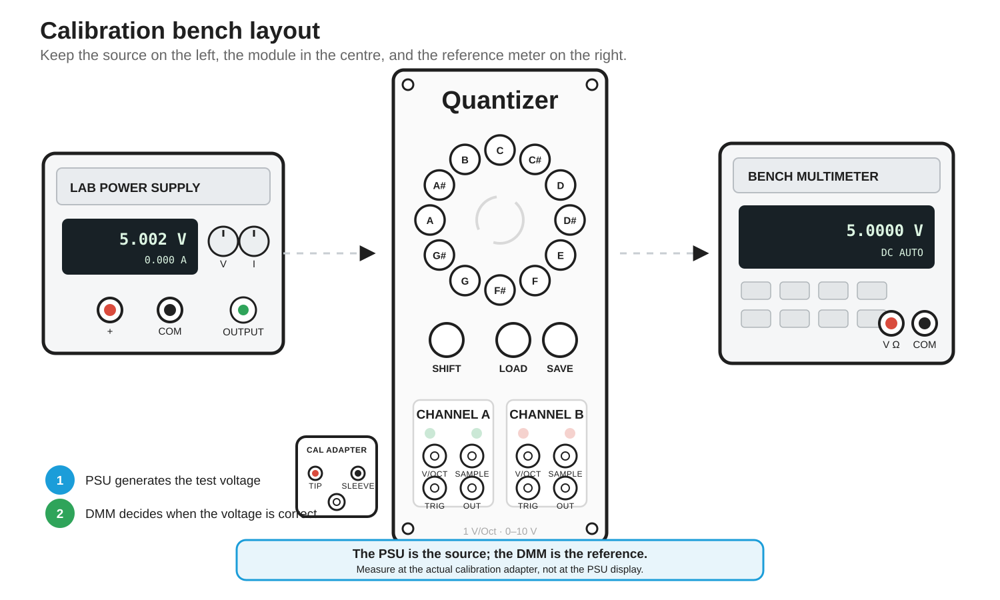
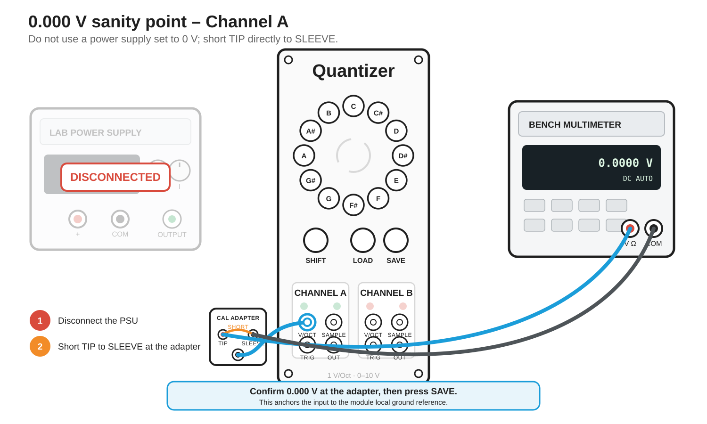
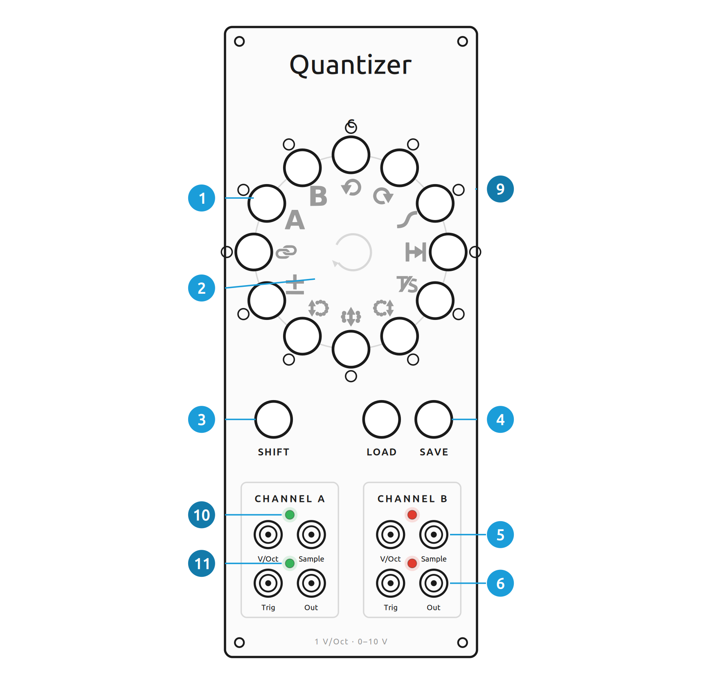
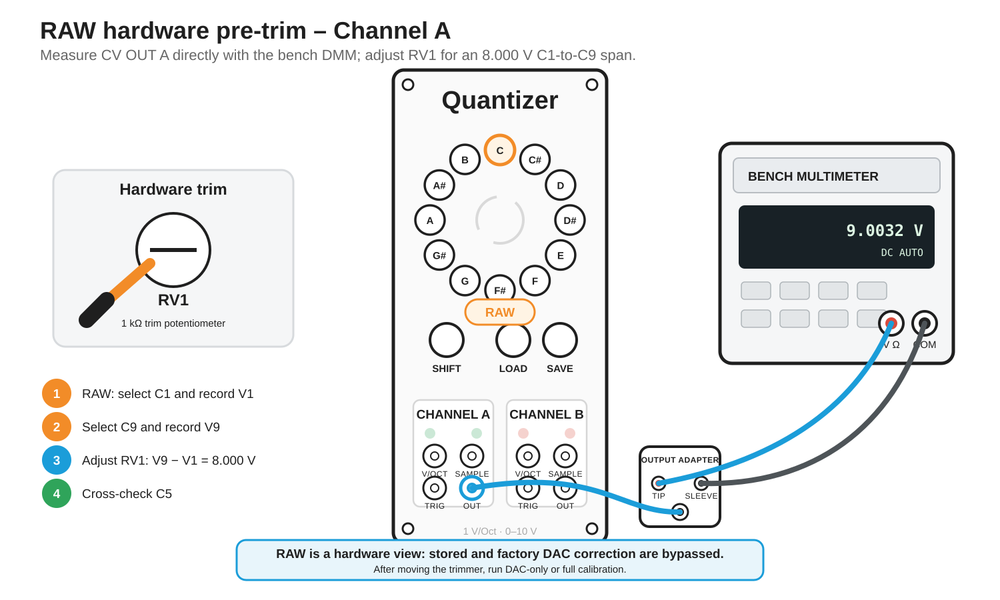
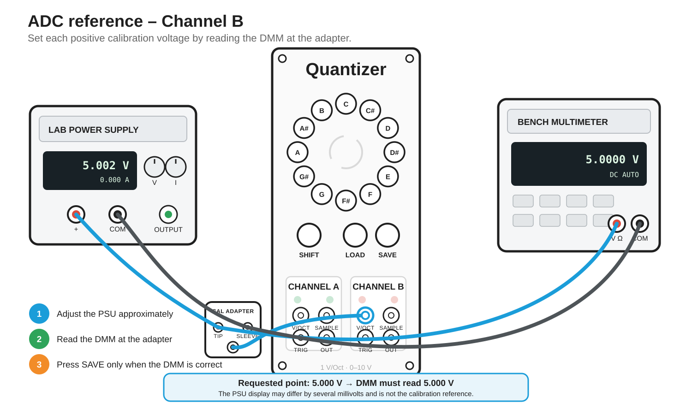
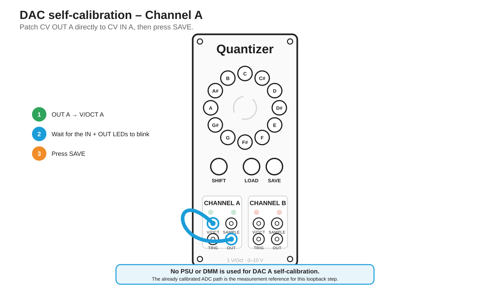
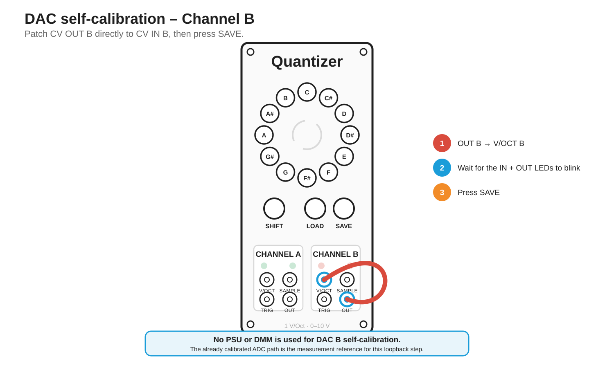
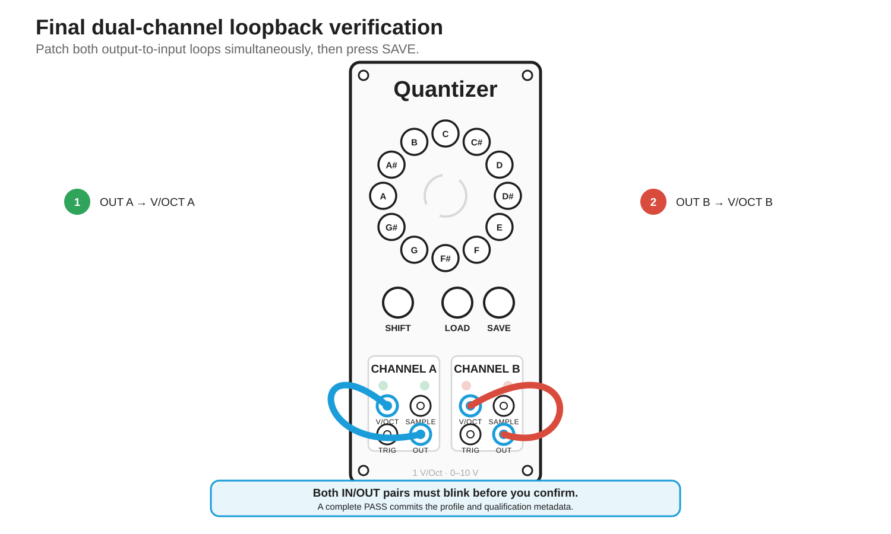
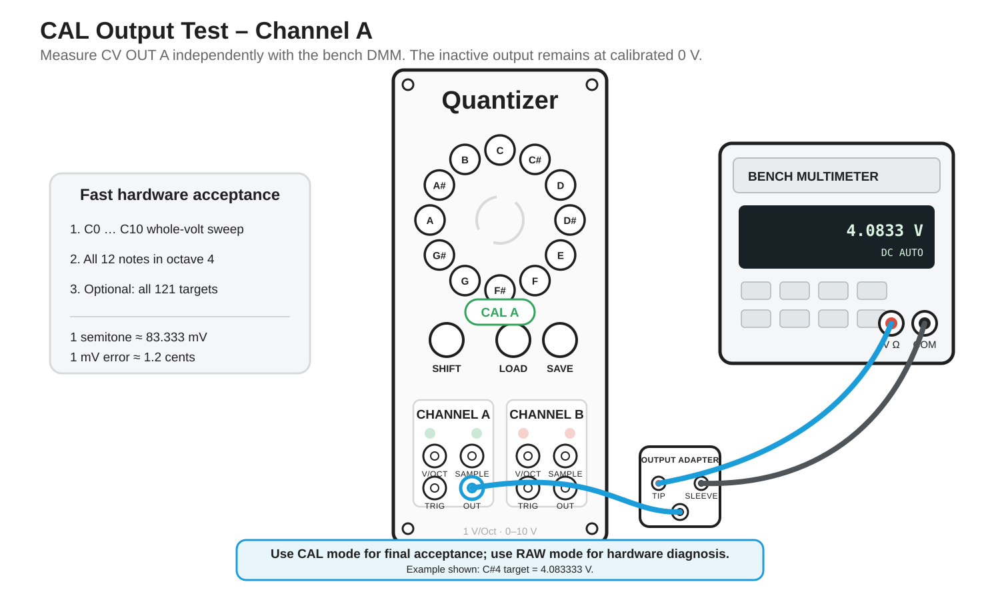

# Analog calibration and maintenance firmware

The Quantizer uses a dedicated maintenance firmware image for hardware calibration, verification, output measurement, and service operations. The maintenance image is front-panel driven; no serial command input is required.

Calibration is **not periodic maintenance**. Run a full calibration only when:

- a newly built module has never been individually calibrated;
- calibration data were deliberately erased or lost;
- the analog CV input/output path or its trimmers were changed; or
- independent measurements show a pitch or 1 V/oct problem.

A normal firmware update does **not** require recalibration as long as EEPROM is preserved.

> [!TIP]
> A self-contained step-by-step browser assistant is available at [`docs/calibration/interactive/index.html`](docs/calibration/interactive/index.html). It guides the complete process from PlatformIO build/upload through the safe power transitions, every analog calibration step, external DMM measurements, stored-report validation and the final production-firmware reflash. This document remains the normative calibration procedure.

## 1. What you need

Prepare the measurement setup before flashing the maintenance image.

### Required

- **A DMM with trustworthy DC-voltage accuracy and millivolt resolution.** A 4.5-digit bench DMM is suitable for this procedure when used consistently.
- **An adjustable low-noise DC source or bench power supply** capable of supplying 0...9 V. The supply is the source only; its display is **not** the calibration reference.
- **Normal Eurorack power** for the actual analog calibration (`+12 V / -12 V / +5 V / GND`).
- **At least one 3.5 mm TS jack breakout/test adapter** with accessible TIP and SLEEVE/GND terminals.
- **Normal Eurorack patch cables** for the DAC loopback steps.
- **DMM probes / banana leads** suitable for the breakout adapter.
- **A USB cable and computer** for flashing the maintenance image and later reading the stored report. USB is not connected during analog calibration.

### Strongly recommended

- A source adapter with a switch or jumper that can short **TIP directly to SLEEVE** for the 0.000 V sanity point.
- A second simple output-measurement adapter so the reference source and DMM wiring do not need to be rebuilt repeatedly.
- An **insulated trimmer screwdriver** if the optional hardware pre-trim is used.

<p align="center"></p>

### Direct patch-cable access and recommended helper adapter

Calibration can be performed without a dedicated adapter when suitable clips, mini-grabbers, or other secure test leads are available. In that case, connect directly to the conductors of a normal 3.5 mm TS patch cable:

- **TIP** is the CV signal conductor;
- **SLEEVE** is the module ground / return conductor.

This is electrically valid, but it is mechanically awkward and makes accidental shorts or intermittent contacts more likely. For repeated calibration work, use a small passive **3.5 mm TS breakout/helper PCB** instead. A practical adapter needs only:

- one 3.5 mm TS jack, for example a Thonkiconn-compatible type;
- clearly identified **TIP** and **SLEEVE / GND** connections;
- terminal pins, screw terminals, test posts, or another secure means of attaching DMM and PSU leads; and
- optionally, a jumper or switch that can short **TIP directly to SLEEVE**.

The helper PCB contains no active circuitry. Its purpose is to make the two conductors of the patch cable mechanically secure, accessible, and unambiguous during calibration.

> [!IMPORTANT]
> Verify the adapter wiring before calibration. **TIP must connect to the CV signal and SLEEVE must connect to GND.** Incorrect or reversed wiring invalidates the measurement setup.

For a **0.000 V reference**, disconnect the external voltage source and short **TIP directly to SLEEVE** at the adapter or patch cable. Do **not** obtain the 0 V reference by setting the bench power supply to `0.000 V`. The required reference is the module's actual local ground potential.

## 2. Measurement rule: the PSU is the source; the DMM is the reference

This rule is mandatory for every positive ADC calibration point:

> **The PSU is the source; the DMM is the reference.**

Do not assume that a bench supply set to `5.000 V` actually produces exactly `5.000 V`. General-purpose laboratory supplies can have set/readback errors of many millivolts even when their displays show three decimal places.

<p align="center"></p>

For every requested positive voltage:

1. Set the bench source approximately to the requested voltage with its output disabled.
2. Use a conservative current limit, for example **5-10 mA**.
3. Connect supply COM / `-` to adapter SLEEVE/GND.
4. Connect supply `+` to adapter TIP.
5. Enable the output.
6. Measure the voltage **at the actual jack adapter** with the DMM.
7. Adjust the supply until the **DMM** reads the requested value.
8. Only then press **SAVE** on the Quantizer.

For the 0.000 V sanity point, do not use a supply set to zero. Short TIP directly to SLEEVE/GND so the CV input sees the module's local ground reference.

<p align="center"></p>

Using the same DMM for calibration and the later independent output sweep is recommended. Its absolute specification still limits absolute accuracy, but a consistent instrument prevents the power-supply display from becoming an uncontrolled calibration reference.

## 3. Front-panel reference and quick controls

<p align="center"></p>

From dim-amber maintenance idle:

| Control | Function |
|---|---|
| **SAVE** | Full ADC + DAC calibration |
| **LOAD** | Verify the currently stored DAC calibration |
| **SHIFT + SAVE** | ADC/input calibration only |
| **SHIFT + LOAD** | DAC/output self-calibration only |
| **Hold SHIFT for 1 s** | Enter output test / RAW service mode |
| **Hold SHIFT + SAVE + LOAD for 5 s** | Arm calibration-data erase |

Inside a calibration wizard:

| Control | Function |
|---|---|
| **SAVE** | Confirm the current wiring/voltage step and continue |
| **LOAD** | Cancel safely; no incomplete calibration is committed |

## 4. Power safety and the three-phase workflow

> [!CAUTION]
> **Never connect normal Eurorack bus power and the Nano USB connection at the same time on this module.** The Eurorack +5 V rail and USB-derived +5 V must not drive the module simultaneously.

Use three physically separate phases:

```text
A. Flash maintenance firmware
   Eurorack ribbon disconnected
   USB connected

B. Perform analog calibration / RAW trim / output tests
   USB completely disconnected
   normal Eurorack ribbon connected

C. Read stored report or flash production firmware
   Eurorack ribbon disconnected
   USB connected
```

During phase B the module must run from its normal `+12 V / -12 V / +5 V / GND` Eurorack supply so the DAC reference and analog stages operate under their real operating conditions.

## 5. Flash the maintenance image

Current Nano bootloader:

```text
pio run -e nanoatmega328new_calibration -t upload
```

Older Nano bootloader:

```text
pio run -e nanoatmega328_calibration -t upload
```

The normal bootloader upload writes program flash only. Do not substitute a chip-erase or EEPROM-upload operation unless EEPROM loss is explicitly intended.

After flashing: disconnect USB completely before reconnecting the Eurorack ribbon.

## 6. Maintenance visual language

| Indication | Meaning |
|---|---|
| Full ring flashes **amber three times** | Maintenance firmware booted |
| Full ring remains **dim amber** | Idle / ready |
| Green pulsing note + channel Input LED | Apply requested ADC reference, then press SAVE |
| Matching IN + OUT LEDs blink | Patch that channel's `CV OUT -> CV IN` |
| Both IN + OUT pairs blink | Patch both loopbacks for final verification |
| Ring off during acquisition | Analog measurement in progress |
| **2 green / 2 red** full-ring flashes | Ordinary PASS / FAIL |
| **3 green / 3 red** full-ring flashes | Final qualification PASS / FAIL |
| **Amber selected note** in output test | RAW output; software DAC correction bypassed |
| **Green/red selected note** in output test | CAL output; stored correction active for A/B |
| **Pulsing full red ring** | Destructive calibration erase awaiting confirmation |

A failed operation is followed by the error code described later in this guide.

## 7. Decide what to do

### Newly built or obviously mismatched A/B hardware

Recommended sequence:

```text
optional erase of old test calibration
-> RAW hardware pre-trim
-> full software calibration
-> calibrated output sweep
-> stored report / label
```

### Existing module that already measures correctly

Do not recalibrate merely because new firmware was flashed. Use **LOAD** for loopback verification or the calibrated Output Test mode for an independent DMM check.

### Input-side hardware was changed

Use **SHIFT + SAVE** or run the full calibration.

### Output-side hardware or RV1/RV2 was changed

Use RAW pre-trim if desired, then **SHIFT + LOAD** or run the full calibration. Any trimmer movement invalidates the previous DAC calibration even though the firmware cannot detect the mechanical change itself.

## 8. Optional hardware pre-trim in RAW mode

The upstream Quantizer output circuit contains two **1 kOhm trim potentiometers, RV1 and RV2**, in the two output-amplifier paths. RAW mode exists specifically to expose that physical DAC/reference/output-stage transfer without software correction. This is useful when Channel A and B require noticeably different software gain coefficients.

RAW mode bypasses **both stored and factory DAC offset/gain correction**. It writes only the ideal nominal DAC code. The mode therefore remains useful even when no calibration record exists.

### Enter RAW output mode

1. From dim-amber idle, **hold SHIFT for 1 second**.
2. If a valid stored profile exists, Output Test starts in CAL mode. Press **SAVE + LOAD together briefly** to toggle RAW/CAL.
3. If no stored profile exists, Output Test starts directly in RAW mode.
4. RAW selection is shown **amber**. CAL selection is green for Channel A and red for Channel B.

Output Test controls:

| Control | Function |
|---|---|
| Note C..B | Select pitch class |
| SAVE | Octave up |
| LOAD | Octave down |
| SAVE + LOAD | Toggle CAL / RAW when a stored profile exists |
| Short SHIFT | Toggle Channel A/B |
| Hold SHIFT 1 s | Exit |

### Preferred gain pre-trim procedure

<p align="center"></p>

A single 9 V adjustment can be influenced by output offset. A better gain-oriented adjustment uses two RAW points:

1. Select the channel to trim.
2. Select **C1 = 1.000 V nominal** and record the DMM reading `V1`.
3. Select **C9 = 9.000 V nominal** and record `V9`.
4. Adjust the matching hardware trim potentiometer in small increments.
5. Repeat C1/C9 until:

```text
V9 - V1 ~= 8.000 V
```

6. Cross-check **C5 = 5.000 V nominal**.
7. Repeat for the other channel.

Use PCB/schematic labeling to identify the matching trimmer; if necessary, make only a very small adjustment and observe which CV output changes.

The goal is a sensible, closely matched physical gain baseline. Do **not** try to force a substantial zero-offset error away with a gain trimmer. Software calibration handles residual affine offset/gain after the hardware has been brought into a reasonable range.

> [!IMPORTANT]
> Any trimmer movement changes the hardware transfer function and invalidates the previous DAC calibration. Always run DAC-only or full software calibration afterwards.

## 9. Full calibration - SAVE

The complete wizard calibrates both inputs, then both outputs, then performs final dual-channel loopback verification. New coefficients remain in RAM until all required steps pass.

### ADC fit and independent verification

Each channel uses ten reference measurements.

**Five fit points** determine one integer least-squares affine line:

| Note | Voltage | Role |
|---|---:|---|
| C# | 1.000 V | Fit |
| D# | 3.000 V | Fit |
| F | 5.000 V | Fit |
| G | 7.000 V | Fit |
| A | 9.000 V | Fit |

**Five independent points** do not influence the fit:

| Note | Voltage | Role |
|---|---:|---|
| C | 0.000 V | Raw zero sanity |
| D | 2.000 V | Verification |
| E | 4.000 V | Verification |
| F# | 6.000 V | Verification |
| G# | 8.000 V | Verification |

The interior fit deliberately avoids both ADC rails. A negative analog offset can disappear below ADC code zero; using 0 V as a fit point would therefore hide information. Likewise 9 V retains headroom below full-scale saturation.

Raw ADC code 0 remains explicitly anchored to calibrated code 0 at runtime.

### Channel A ADC

<p align="center"></p>

Follow the pulsing green note instructions for `1/3/5/7/9 V`, then `0/2/4/6/8 V`. For every positive point, adjust the source until the **DMM at the jack adapter** reads the requested value. Press SAVE only after the DMM is correct.

### Channel B ADC

<p align="center"></p>

Move the reference connection to CV IN B and repeat the same ten-point sequence.

### DAC A self-calibration

<p align="center"></p>

When Channel A IN and OUT LEDs blink together:

```text
CV OUT A -> CV IN A
```

Press SAVE. The firmware drives several DAC points, measures them through the already calibrated ADC A path, fits an affine DAC correction, and independently verifies it.

### DAC B self-calibration

<p align="center"></p>

When Channel B IN and OUT LEDs blink together:

```text
CV OUT B -> CV IN B
```

Press SAVE.

### Final dual-channel verification

<p align="center"></p>

When both IN/OUT pairs blink, patch both loopbacks simultaneously:

```text
CV OUT A -> CV IN A
CV OUT B -> CV IN B
```

Press SAVE. Only a complete PASS commits the new profile and generation-bound qualification data to EEPROM. Three green flashes indicate qualification PASS.

## 10. Partial workflows

### ADC only - SHIFT + SAVE

Runs the ten-point ADC fit/verification sequence for A and B and saves the resulting ADC profile. Because the input reference has changed, any previous DAC qualification must be considered invalid until DAC-only or full calibration is run afterwards.

### DAC only - SHIFT + LOAD

Requires a valid stored ADC calibration. Performs A selfcal, B selfcal, and final dual-loop verification, then commits the new DAC profile and qualification metadata.

### Verify stored calibration - LOAD

Does not change ADC/DAC coefficients. Patch both loopbacks when requested and press SAVE. PASS refreshes qualification metadata for the current calibration generation only.

### Cancel safely

Press LOAD during a wizard prompt. Incomplete coefficients remain uncommitted and the previously active profile is restored.

## 11. Output Test: calibrated and RAW measurements

<p align="center"></p>

Hold SHIFT for one second from idle to enter Output Test.

- With a stored calibration, the mode starts in **CAL**.
- Without a stored calibration, it starts in **RAW**.
- Press **SAVE + LOAD together** to toggle CAL/RAW when CAL is available.

The inactive output is held at zero. Octave 10 contains only C10 = 10.000 V.

Target voltage is:

```text
voltage = octave + pitchClass / 12 volts
```

Example, octave 4:

| Note | Target |
|---|---:|
| C | 4.000000 V |
| C# | 4.083333 V |
| D | 4.166667 V |
| D# | 4.250000 V |
| E | 4.333333 V |
| F | 4.416667 V |
| F# | 4.500000 V |
| G | 4.583333 V |
| G# | 4.666667 V |
| A | 4.750000 V |
| A# | 4.833333 V |
| B | 4.916667 V |

A C-only whole-volt sweep checks zero, octave scale, and gross 1 V/oct gain. It does **not** physically prove every chromatic step. For fast hardware QA:

1. Measure C at every octave.
2. Measure all twelve notes in one middle octave, for example octave 4.

For exhaustive physical qualification, measure all 121 targets C0...C10. One semitone is approximately 83.333 mV; 1 mV error is approximately 1.2 cents.

RAW mode is the right view for hardware-trimmer work. CAL mode is the right view for checking the finished stored DAC correction.

## 12. Erase stored calibration data

Erasing calibration is intentionally difficult to trigger accidentally.

1. From dim-amber idle, hold **SHIFT + SAVE + LOAD together for 5 seconds**.
2. Release the buttons when the full ring begins pulsing red.
3. Press **SAVE** to confirm the erase, or **LOAD** to cancel.
4. A completed erase is acknowledged by **three amber flashes** and returns to dim-amber idle.

The operation invalidates:

- both redundant ADC/DAC calibration journal records; and
- the stored qualification/label metadata.

It does **not** erase user scales, full-configuration presets, or the musical live-state ring.

After erase there is no stored module-specific calibration. Production firmware falls back to `AnalogConfig.h` factory defaults until a new profile is calibrated and saved. RAW Output Test remains available because it does not depend on any calibration record.

## 13. Stored calibration report and label

The maintenance image has no writable serial console. Serial output is read-only.

After successful qualification:

1. Power the case OFF.
2. Disconnect the Eurorack ribbon.
3. Connect USB.
4. Open a serial monitor at 115200 baud.

On boot the firmware prints the newest stored calibration and its matching qualification generation. The USB-only report does not perform a fresh analog measurement because the +/-12 V analog stages are intentionally unpowered in this phase.

A label block is emitted only when a matching verified qualification exists. Date, serial number, and tester identity remain host-side or handwritten metadata because the Nano has no real-time clock.

## 14. Error codes

A failure is shown as two red flashes followed by a static number of red note LEDs:

| Red LEDs | Meaning |
|---:|---|
| 1 | Input unstable or ADC acquisition timeout |
| 2 | ADC fit or independent verification invalid |
| 3 | Loopback missing, wrong, or non-monotonic |
| 4 | Loopback range/gain/fit implausible |
| 5 | Independent DAC verification residual too large |
| 6 | Required persistent profile unavailable or persistence failed |

Press LOAD to acknowledge the error and return to idle.

## 15. EEPROM isolation and power-fail behavior

The current Unreleased EEPROM layout is intentionally partitioned:

| EEPROM bytes | Purpose |
|---:|---|
| `0..503` | User scale/full-configuration presets |
| `504..965` | 11-slot wear-leveled live-state ring |
| `966` | Qualification marker / legacy <=0.2.1 migration marker |
| `967..1022` | Two redundant 28-byte calibration records |
| `1023` | Packed A/B qualification residuals |

The writable `CalibrationStore` receives an EEPROM partition exposing only `967..1022`, so it cannot address presets or live state. The qualification component can touch only bytes 966 and 1023.

The calibration journal is redundant, CRC-protected, versioned, and committed marker-last. Erase invalidates only the journal markers; stale payload bytes are unreachable and intentionally not rewritten, reducing EEPROM wear.

A direct upgrade from <=0.2.1 migrates a newest legacy twelfth live-state slot before byte 966 is reused as qualification metadata.

## 16. What loopback self-calibration can and cannot prove

Loopback sees the composition of the output path and the already calibrated input path. It can correct output offset and gain relative to that ADC reference, but it does not create an independent absolute voltage standard.

That is why final hardware acceptance should include DMM measurements in CAL Output Test mode. RAW/CAL comparison is also useful diagnostically:

- RAW A/B mismatch -> primarily physical output-stage mismatch;
- RAW close, CAL wrong -> software profile or calibration workflow problem;
- RAW and CAL both nonlinear at the same locations -> investigate DAC/reference/analog hardware rather than adding more affine correction.

## 17. Return to production firmware

1. Power the Eurorack case OFF.
2. Disconnect the ribbon.
3. Connect USB.
4. Flash the production image.
5. Disconnect USB.
6. Reconnect the normal Eurorack ribbon.
7. Power the case ON.

Normal flash-only uploads preserve EEPROM calibration.

## 18. Recommended final acceptance

For a newly built module:

1. Optional RAW hardware pre-trim if A/B output scale is noticeably different.
2. Full calibration with DMM-referenced 1/3/5/7/9 V fit points and independent 0/2/4/6/8 V verification.
3. Final DAC loopback qualification PASS.
4. CAL Output Test: C at all octaves.
5. CAL Output Test: all twelve notes in one middle octave.
6. Read and archive the stored USB report.
7. Apply a calibration label only when qualification and external measurements are satisfactory.

The objective is not to make software hide a badly adjusted analog stage. RAW pre-trim establishes a good hardware baseline; the affine firmware calibration then removes the remaining practical offset/gain error.
